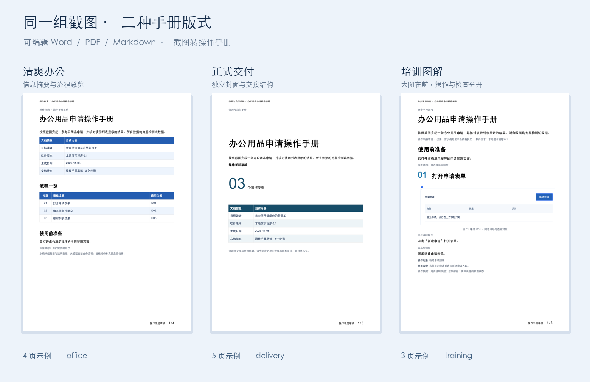

<div align="center">

# 截图转操作手册

**让操作截图，成为清晰、可编辑、可移交的图文指南。**

Screenshot to Manual · 跨客户端 Agent Skill

[快速开始](#快速开始) · [工作流程](#工作流程) · [文档模板](#文档模板) · [交付内容](#交付内容)

</div>

截图转操作手册将用户提供的操作截图与简要说明，整理成带步骤编号、重点标注和待补充清单的图文手册，适用于软件交付、员工培训、客服支持和内部流程说明。

当前Agent负责理解界面和业务语境，结构化步骤保留依据与不确定性，本地工具负责图片处理、文档生成和资源打包。截图没有展示的动作、权限或业务结果，继续作为待确认信息呈现。

## 核心能力

| 需求 | 提供的支持 |
| --- | --- |
| 截图散落、步骤不清 | 登记图片来源，结合用户说明梳理顺序，保留缺图和推断提示 |
| 控件位置不易找到 | 在处理副本上框选重点区域，支持局部裁切放大 |
| 培训材料含个人信息 | 根据经复核的区域做像素遮盖，重新编码图片去除原有元数据 |
| 需要正式图文手册 | 输出可编辑Word、可打印PDF和便于维护的Markdown |
| 转交后图片丢失 | 使用相对路径资产，提供包含文档和派生图片的移交ZIP |
| 输入和版本需要保留 | 每次生成独立目录，原图只读，来源变更要求重新登记 |

支持桌面与手机截图、同一手册中的混合尺寸，以及各行业已有软件操作说明。首版输入为PNG/JPEG；不包括自动录屏、账号采集或业务系统代操作。

## 工作流程

| 阶段 | 处理内容 | 可查看的结果 |
| --- | --- | --- |
| 01 资料登记 | 核对图片尺寸、摘要、重复与读取限制，登记文字说明 | 来源索引与读取提示 |
| 02 图像阅读 | 逐图识别按钮、字段和当前状态 | 有截图依据的界面观察 |
| 03 步骤整理 | 结合用户顺序和说明区分明确、推断及缺失步骤 | 结构化步骤与问题提纲 |
| 04 隐私与标注 | 复核敏感区域，先遮盖像素再裁切、框选重点 | 独立派生图片 |
| 05 校验与导出 | 检查来源、坐标和字段，生成实际可用格式 | Word、PDF、Markdown与移交包 |
| 06 交付复核 | 检查每页图文、可读性、脱敏与缺口 | 供实际操作者核对的手册草稿 |


## 文档模板

内置三套可编辑Word版式，共用同一份步骤和截图，PDF沿用所选版式。根据手册用途调整阅读顺序、信息层次与分页，让内容适合实际使用场景。



| 模板 | 适合场景 | 排版结构 | 实际样张 |
| --- | --- | --- | --- |
| 清爽办公 `office` | 日常流程、内部SOP | 文档信息、流程总览、前置条件；醒目步骤编号，短步骤可连续排布 | [PDF](examples/template-previews/office/操作手册.pdf) · [Word](examples/template-previews/office/操作手册.docx) |
| 正式交付 `delivery` | 项目交接、正式发放 | 独立封面、步骤总数、阅读说明与总览；分步分页，操作与完成标志分层 | [PDF](examples/template-previews/delivery/操作手册.pdf) · [Word](examples/template-previews/delivery/操作手册.docx) |
| 培训图解 `training` | 新员工、现场带教 | 大图优先、大号步骤编号；“现在这样操作”和“完成后检查”分开呈现 | [PDF](examples/template-previews/training/操作手册.pdf) · [Word](examples/template-previews/training/操作手册.docx) |

直接说“做成培训图解版”或“用正式交付版”即可。未指定用途时默认清爽办公，命令行使用`--template office|delivery|training`选择。标题、正文与表格保持原生Word结构，Markdown保持统一的维护格式。上图和样张来自同一组演示资料的实际导出。

## 快速开始

### 1 选择安装方式

- [通用Skill包 v0.1.0](releases/0.1.0/screenshot-to-manual-0.1.0.zip)：用于支持Agent Skills目录或可显式读取Skill的客户端。
- [WorkBuddy专用包 v0.1.0](releases/0.1.0/screenshot-to-manual-workbuddy-0.1.0.zip)：在「专家·技能·连接器 → 技能 → 添加技能 → 上传技能」中导入。

通用包解压后，把完整`screenshot-to-manual`目录放到客户端技能根目录中。源码仓库提供项目级安装器：

```bash
python3 tools/install.py --client codex --project /path/to/project --dry-run
python3 tools/install.py --client codex --project /path/to/project
```

`--client`还支持claude、cursor、copilot、gemini、opencode及generic；`--scope user`选择用户范围。默认拒绝覆盖已有安装，显式`--replace`先备份。自定义技能目录使用`--dest /path/to/skills`。其他Agent可读取技能目录中的SKILL.md，并按其流程使用用户提供的图片。

具体目录与客户端实测状态见[兼容说明](docs/compatibility.md)。发现Skill不代表宿主具有看图、执行Python或导出文档能力。

### 2 提供截图和说明

```text
使用截图转操作手册，把这些后台截图整理成给新员工看的图文指南。
按我提供的顺序排列，标出需要点击的位置，遮盖申请人的个人信息。
生成Word、PDF和可移交的Markdown图片包；看不清或缺失的步骤保留待确认。
```

可补充目标读者、软件版本、已有步骤说明、标题和模板用途。信息不足时先生成有依据的部分，集中列出问题；用户不必先填写完整问卷。

### 3 审阅并移交

先检查正文、图片遮盖和步骤是否符合实际，再使用移交ZIP交给读者。修改截图后重新登记来源、核对坐标，不覆盖原图和旧产物。

## 交付内容

| 文件 | 用途 |
| --- | --- |
| 操作手册.docx | 可编辑图文手册，需要python-docx |
| 操作手册.pdf | 阅读与打印，需要Word导出及LibreOffice |
| 操作手册.md、assets目录 | 可持续维护的文档及相对路径派生图片 |
| 待补充信息.md | 缺图、排序、推断和完成标志等待核对事项 |
| 操作手册-移交包.zip | 汇集可用文档、图片与缺口清单，不含来源JSON和原图 |
| 工作资料、交付清单.json | 内部步骤、来源、检查报告、输出状态与摘要 |

所有文档默认标记为草稿。Word/PDF依赖缺失时明确报告，交付已经成功生成的格式。内部工作资料可能含原始说明与本地路径，单独保留。

## 运行环境

Python3.9+，Pillow负责图片读取与处理；Word使用可选python-docx，PDF需要LibreOffice。优先利用Agent宿主已有环境；包内不附带运行时或字体，不需要额外模型API密钥。

图片仍由当前Agent宿主按其服务规则处理，包内脚本没有联网逻辑。每批1至20张图片，单文件10MiB，单图4000万像素，累计1.2亿像素；更大资料应分批处理。

[命令与故障处理](skills/screenshot-to-manual/references/runtime.md) · [步骤数据协议](skills/screenshot-to-manual/references/schema.md)

## 示例与验证

[查看示例PDF](examples/sample-manual/操作手册.pdf) · [可编辑Word](examples/sample-manual/操作手册.docx) · [完整移交包](examples/sample-manual/操作手册-移交包.zip)


仓库提供实际运行的[虚构演示程序](examples/demo-app/index.html)，通过浏览器操作并截图，展示“新建申请 → 填写提交 → 核对结果”。桌面、手机及混合尺寸共三组，使用同一业务流程验证不同图文形态；不是三个独立软件或全行业正确率评测。

演示原图、人工预期步骤、截图坐标记录和复现工具保存在examples与tools。人工预期模型验证工程流程；真实Agent任务和客户端验证分别记录。

## 验证与边界

详见[本版验证报告](evidence/0.1.0/verification.md)。脚本检查结构、引文、摘要和坐标；截图语义、点击效果、隐私覆盖完整性、业务完成与实际读者体验仍需复核。图片文字模糊或缺少中间页面时，Skill应保留缺口。

开发命令：

```bash
python3 -m unittest discover -s tests -v
python3 tools/build_release.py
python3 tools/smoke_archive.py
```

测试环境需要Pillow，Word相关用例按可选依赖运行；不会将固定样例通过写成所有客户端、行业或操作均已验证。

## 项目状态

v0.1.0已实现标准与WorkBuddy双包、三套文档模板和可复现示例，验证范围与限制见本版报告。市场提审和仓库公开尚未执行。许可证、收费与公开范围另行决定。

[版本记录](CHANGELOG.md) · [产品设计](memory-bank/design.md) · [开发待办](memory-bank/todo.md) · [校验摘要](releases/0.1.0/SHA256SUMS)

Created by [zcjunblog](https://github.com/zcjunblog)
