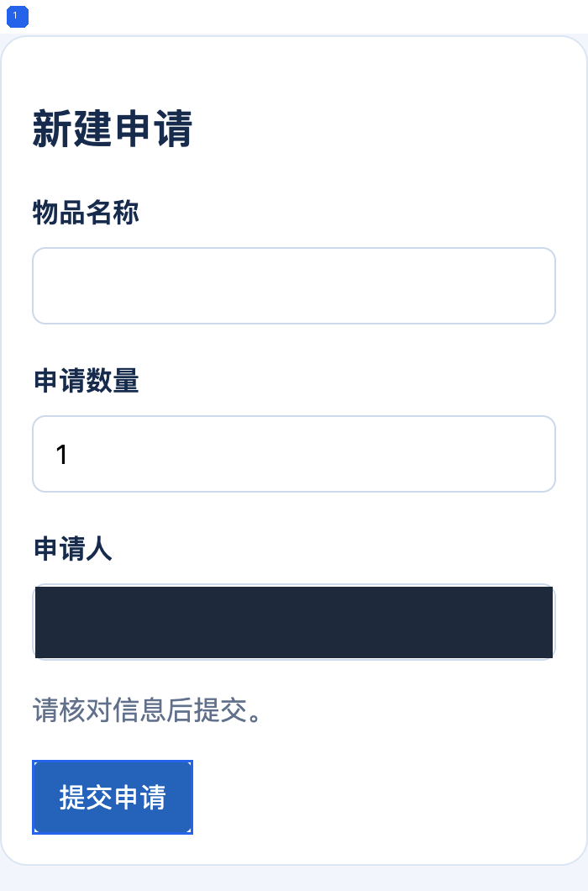

# 办公用品申请操作手册

操作手册草稿

按照截图完成一条办公用品申请，并核对演示列表显示的结果。所有数据均为虚构测试数据。

**目标读者：** 首次使用演示台的新员工

**软件版本：** 本地演示程序0\.1

**步骤顺序：** 用户提供的顺序

本稿依据提供的截图和说明整理，尚未验证完整业务流程。请核对待补充信息后再使用。

## 使用前准备

已打开虚构演示程序的申请管理页面。

## 1 打开申请表单

**依据：** 用户说明依据

**操作对象：** 新建申请按钮

**操作：** 点击“新建申请”打开表单。

**当前界面：** 当前显示申请列表与新建申请入口。

图1 · 来源 I001

重点标注：1；编号与同色边框对应。

**用户说明的预期状态：** 显示新建申请表单。

## 2 填写信息并提交

**依据：** 用户说明依据

**操作对象：** 物品名称与申请数量字段和提交申请按钮

**操作：** 在“物品名称”填入“演示笔记本”，将“申请数量”改为2，然后点击“提交申请”。

**当前界面：** 当前显示物品名称、申请数量和申请人字段；演示申请人区域已按要求遮盖。

图2 · 来源 I002

重点标注：1；编号与同色边框对应。

**用户说明的预期状态：** 提交后返回列表，演示页显示提交成功。

## 3 核对列表结果

**依据：** 用户说明依据

**操作对象：** 提交成功提示与申请列表

**操作：** 提交后在列表核对“演示笔记本”、数量2和“待处理”状态。界面提示只证明演示页显示，不能代表采购审批完成。

**当前界面：** 当前显示提交成功提示，列表内有演示笔记本，数量2，状态待处理。

图3 · 来源 I003

重点标注：1；编号与同色边框对应。

**用户说明的预期状态：** 列表显示与用户说明相符；采购审批或后台业务结果不在本次截图验证范围。

## 待补充信息

当前没有单列缺口；仍需实际操作者核对步骤与结果。
